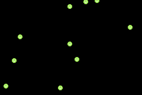

# Bouncers
An exercise to learn about functions and classes.

Please find instructions in [instructions.md](instructions.md).

## Controls
- Press **A** to create new bouncer
- Press **B** to write average x position to the console (for debugging) 

